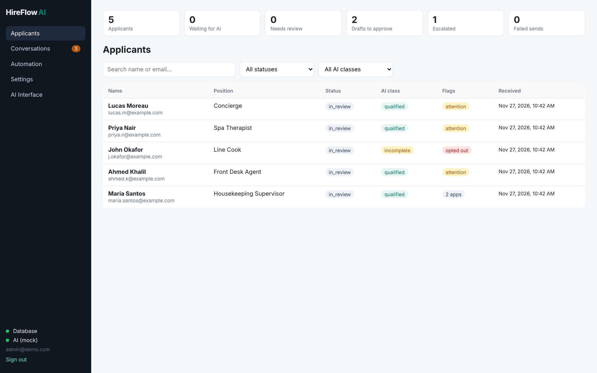
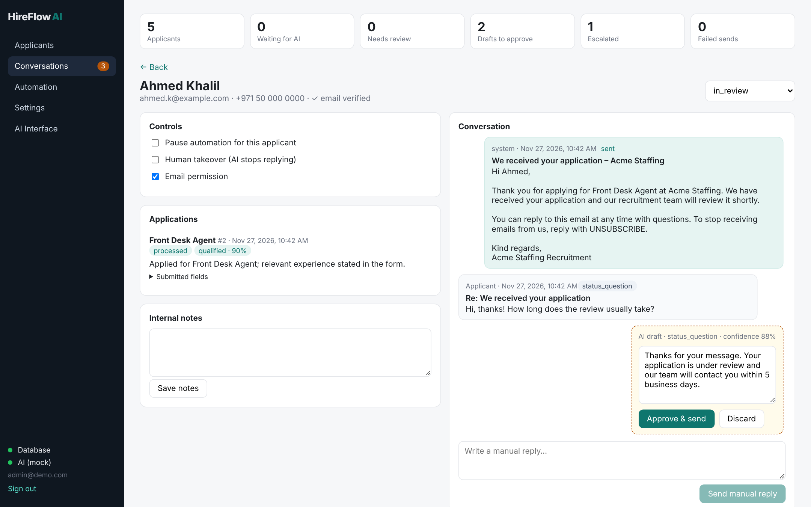
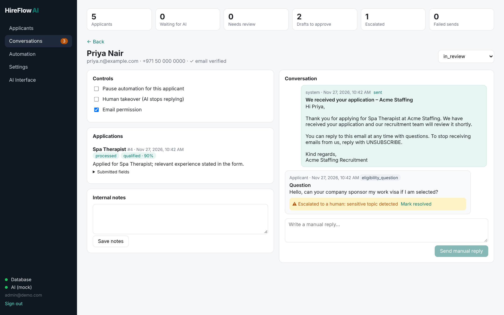
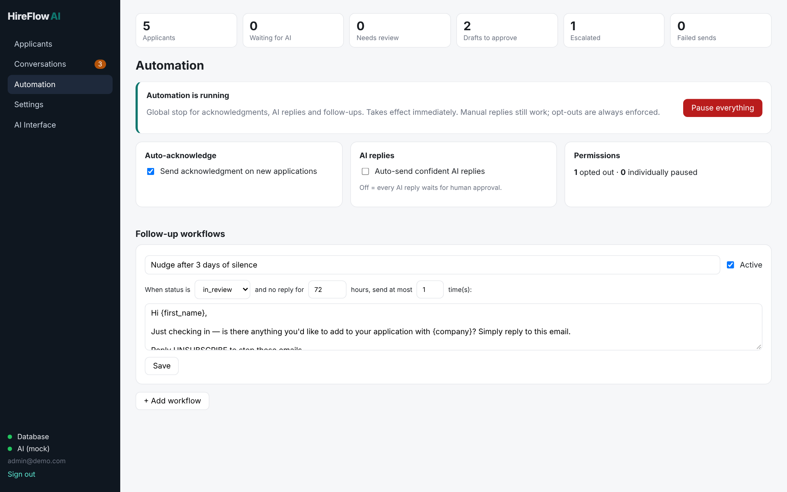
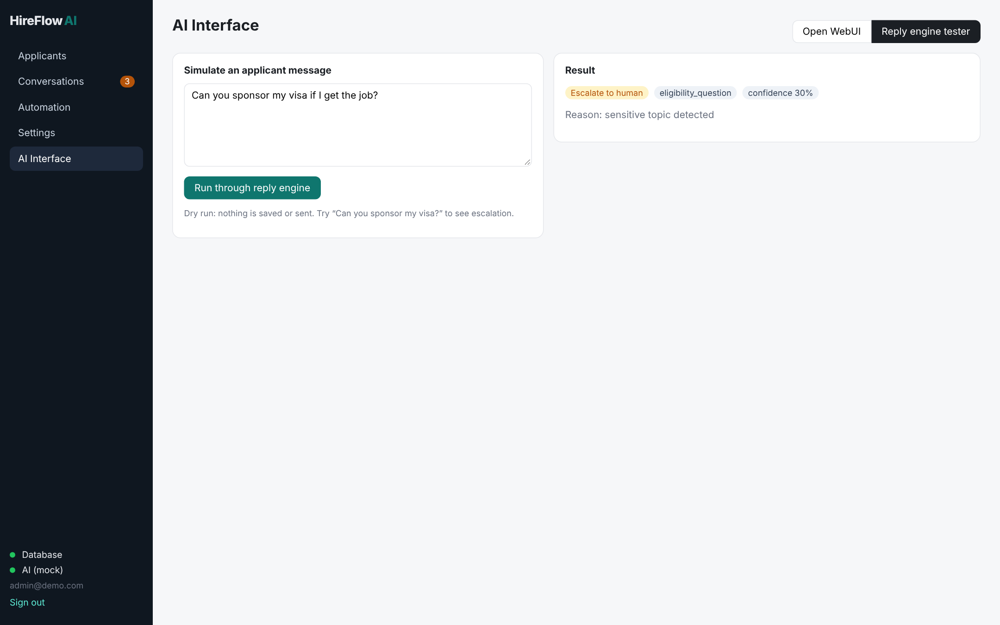

# HireFlow AI: Self-Hosted AI Recruitment & Communications Platform

A self-hosted platform that takes job applications from an existing WordPress site, triages them with a local LLM (Ollama / Qwen3), manages applicant email conversations with AI-drafted replies under human oversight, and gives recruiters one dashboard for applicants, conversations, automation controls and an embedded Open WebUI.

The whole stack runs from one `docker compose up` next to an existing website, without modifying it.



## What it does

| Area | Implementation |
|---|---|
| **WordPress intake** | Small connector plugin (Contact Form 7 / WPForms / Gravity Forms / custom hook). Signed HMAC webhook with replay protection. **Local queue + WP-cron retry**, so applications are never lost if the platform is down. |
| **Duplicate detection** | Idempotent re-delivery (same entry ID) plus a same-person-same-role fingerprint within 30 days. Duplicates are linked to the original and don't get a second acknowledgment. |
| **AI triage** | Each application is classified (`qualified / needs_info / incomplete / spam`) with a recruiter summary and a confidence score. Low confidence goes to *needs review*. |
| **Outage resilience** | Intake has **no dependency on the AI**. Applications are stored as `pending`, the templated acknowledgment still goes out, and the worker processes the backlog when inference recovers. |
| **Email** | IMAP polling of one designated mailbox (designed for more). Sender and thread matching (`In-Reply-To`), Message-ID de-duplication, quoted-text stripping, SMTP replies threaded correctly, and every delivery failure recorded and retried. |
| **Guarded AI replies** | Answers come only from the editable knowledge base. Code-level guardrails escalate to a human on low confidence, sensitive topics (visa, legal, eligibility, complaints) or any drafted "decision" statement. **The AI never makes hiring or eligibility decisions.** |
| **Human oversight** | Drafts wait for approval by default (auto-send is opt-in). Recruiters can edit, approve, discard, take over a conversation, or reply manually. |
| **Automation controls** | Global kill switch, per-applicant pause, configurable follow-up workflows, and **immediate opt-out** ("UNSUBSCRIBE" reply), which even blocks manual sends. |
| **Security** | bcrypt + JWT (httpOnly cookie), admin management, full audit log, HMAC webhooks, nightly AES-256-encrypted backups with a restore script, non-root containers, and a single port bound to localhost for Cloudflare Tunnel. |
| **Open WebUI** | Embedded in the dashboard at `/ai/`, gated by the **same login** via nginx `auth_request` and trusted-header SSO. If Open WebUI is down, the main platform keeps running. |

## Architecture

```
 WordPress (existing, untouched) ──HMAC webhook──┐
   └─ hireflow-connector plugin (local queue)    │
                                                 ▼
 Cloudflare Tunnel ──► gateway (nginx) ──► api (FastAPI) ──► db (PostgreSQL 16, separate from MariaDB)
                         │  /   React dashboard     ▲
                         │  /ai Open WebUI ─────────┼──► ollama (qwen3:8b)
                         │      (auth_request)      │        ▲
                         │                      worker ──────┘  IMAP poll · AI triage · replies · follow-ups
                         │                          └──► SMTP
                       backup (nightly encrypted pg_dump)
```

More detail: [docs/ARCHITECTURE.md](docs/ARCHITECTURE.md)

## Choosing the model

The LLM sits behind one `LLMProvider` interface, so the backend is a config switch (`LLM_PROVIDER`):

- **`ollama` (default):** fully self-hosted, so data never leaves the server. `qwen3:8b` handles classification and short knowledge-base-grounded replies well, using about 6 GB RAM/VRAM (Q4). On a CPU-only server, use `qwen3:4b` for faster responses.
- **`anthropic`:** Claude API, for teams that prefer hosted quality over self-hosting. Use a small, fast model (Haiku class) for triage and routing, and a larger one (Sonnet class) only where reply quality matters most.
- **`mock`:** deterministic, offline. Used by the test suite and demo mode.

Whichever model runs, the safety rules live in code (`services/ai_engine.py`), not only in the prompt, so swapping models can't remove the guardrails.

## Quick start

```bash
cp .env.example .env          # set every CHANGE value
docker compose up -d --build  # first start pulls the model (several GB)
open http://localhost:8088     # log in with ADMIN_EMAIL / ADMIN_PASSWORD
```

Then install `wordpress-plugin/hireflow-connector` on the site and enter the platform URL and `WEBHOOK_SECRET`. Full guide: [docs/DEPLOYMENT.md](docs/DEPLOYMENT.md)

**Demo mode** (no GPU, no mailbox, no `.env`). This starts the dashboard with sample data:

```bash
docker compose -f docker-compose.demo.yml up --build
# open http://localhost:8088  ->  admin@demo.com / demo-password-123
```

## Tests

21 automated tests cover each of the 14 acceptance workflows plus security and edge cases. They run against SQLite and PostgreSQL:

```bash
cd backend && pip install -r requirements.txt     # Python 3.11+
pytest -q                                                   # SQLite
TEST_DATABASE_URL=postgresql+psycopg2://... pytest -q       # PostgreSQL
```

Mapping of acceptance criteria to tests: [docs/ACCEPTANCE_TESTS.md](docs/ACCEPTANCE_TESTS.md)

## Repository layout

```
backend/            FastAPI app, worker, Alembic migrations, tests, demo seeder
  app/llm/          provider interface: Ollama, Claude API, mock
  app/services/     intake, ai_engine (guardrails), processing, inbox, mailer, follow-ups, audit
frontend/           React (Vite) dashboard + nginx gateway config
wordpress-plugin/   hireflow-connector (form adapters + offline queue)
scripts/            encrypted backup loop, restore
docs/               architecture, deployment, security & backup, acceptance tests, OpenAPI, screenshots
```

## Status and limits

This is a portfolio and reference build. It isn't deployed for a client.

- Verified here: the backend and test suite on SQLite and PostgreSQL 16, the Alembic migration, the dashboard build, the nginx gateway (including the Open WebUI login gate), the compose file, and PHP syntax of the plugin.
- The screenshots use demo mode (`mock` provider).
- Not verified yet: the full compose stack on a Docker host with Ollama/Qwen3 and Open WebUI, and the plugin inside a live WordPress install.
- Knowledge-base retrieval is keyword-based. For a large knowledge base, the next step is pgvector embeddings.

## Screenshots

| | |
|---|---|
|  AI draft awaiting approval |  Visa question escalated to a human |
|  Kill switch and follow-up workflows |  Reply-engine tester |
